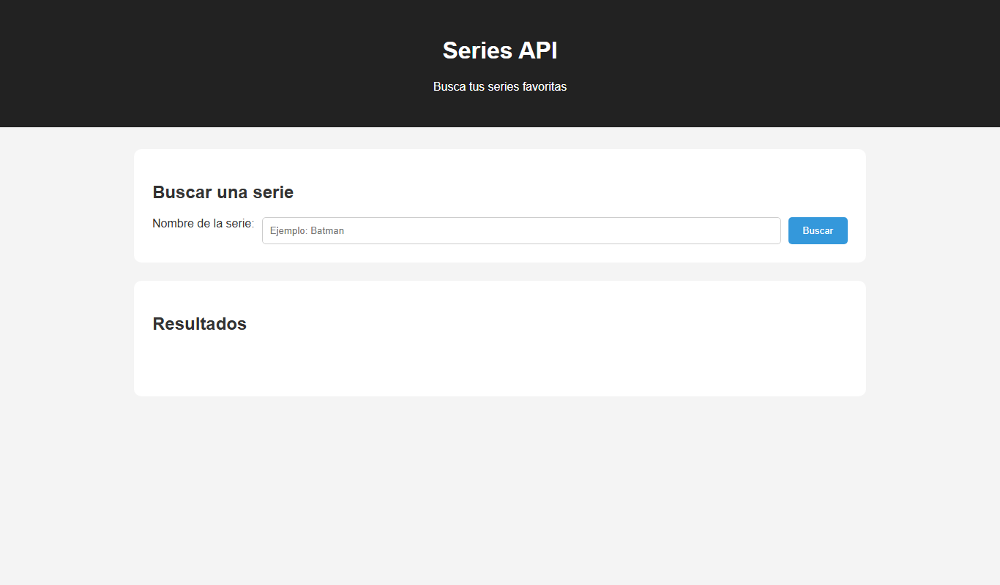

# Series API

Buscador de series de televisión que consume la API pública de [TVmaze](https://www.tvmaze.com/api).

**Sitio en línea:** https://moremaster123.github.io/Pagina-API/

## Tecnologías

- HTML5
- Sass
- JavaScript
- Axios

## Cómo funciona

1. Escribes el nombre de una serie y presionas Buscar.
2. Se hace una petición a `https://api.tvmaze.com/search/shows?q=<nombre>`.
3. Con el ID del primer resultado se hace una segunda petición a `https://api.tvmaze.com/shows/<id>` para traer el detalle.
4. Se muestran los datos de la serie. Si no hay resultados, aparece un aviso.

## Cómo verlo en local

Abre `index.html` en el navegador. Para editar los estilos, compila Sass:

```bash
sass SASS/main.scss SASS/main.css --watch
```

## Captura



## Autor

Juan Carlos González Herrera · [LinkedIn](https://www.linkedin.com/in/juan-carlos-desarrollador-web) · [Portafolio](https://moremaster123.github.io)
